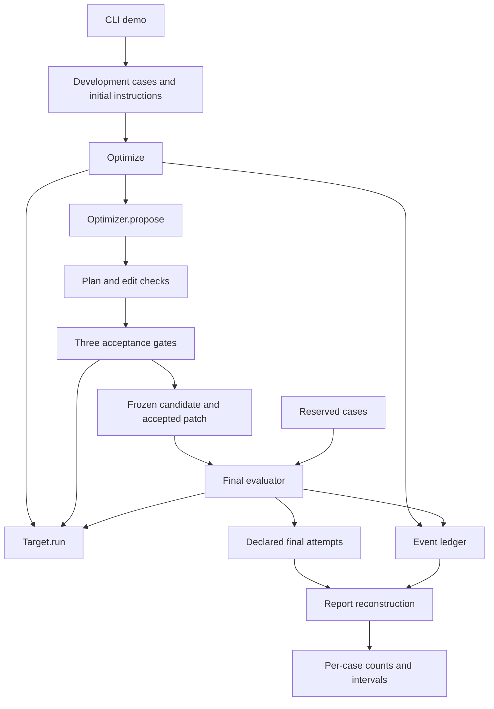

# Agent Optimization Loop: complete technical document

This document explains the design, code, data, results, and operating procedures.
The first part retains the worked lessons for weeks 7 and 8.
The detailed reference explains each implemented contract and each pending live component.

| Read this part                                                          | To understand                                             |
| ----------------------------------------------------------------------- | --------------------------------------------------------- |
| [Worked search lesson](#week-7-1-goal-expectation-and-value)            | The purpose and a concrete accepted edit                  |
| [Worked evaluation lesson](#week-8-1-goal-expectation-and-value)        | Separate measurement and the observed result              |
| [Purpose and glossary](#1-purpose-and-completion-state)                 | The scope, terms, and completion state                    |
| [Architecture and data](#3-architecture-and-dependencies)               | Components, dependencies, cases, and split boundaries     |
| [Instruction boundary](#5-instruction-representation-and-edit-checks)   | Permitted text changes and exact rejection rules          |
| [Search and gates](#6-discovery-and-failure-groups)                     | Discovery, proposals, paired attempts, and acceptance     |
| [Worked event trace](#9-complete-scripted-search-trace)                 | Every proposal and its measured gate outcome              |
| [Records and hashes](#10-ledger-format-and-failure-records)             | Event fields, exceptions, persistence, and saved files    |
| [Final evaluation](#12-final-evaluation-and-the-lock)                   | The lock, denominator, calculation, and per-case evidence |
| [ACI adapter](#16-optional-aci-adapter)                                 | The pinned runtime and instruction replacement            |
| [Commands and tests](#17-command-reference-and-reproduction)            | Reproduction, coverage, and recovery                      |
| [Live work and costs](#20-proposed-live-experiment-and-cost)            | Planned limits, estimates, and missing components         |
| [Publication and prose](#22-publication-provenance-and-document-checks) | Provenance, artifact checks, and STE limits               |

An optimizer can select an edit that helps familiar examples but fails on new cases.
The lesson builds a small experiment that can expose that difference.
This checkpoint uses a scripted model. It does not measure model skill.

Here is the first concrete example.
[The development input](data/development.json) contains the `merge-intervals` issue and source.
The original fixture result is `{"submitted": false}`.
The accepted fixture result is `{"submitted": true}`.
[The ledger](results/offline-verified/ledger.jsonl) saves both exact inputs and outputs.
[The patch](results/offline-verified/patch-01.diff) adds this real instruction text:

```text
Check every issue requirement, then submit the completed repair.
```

The code below deliberately assigns fixture outcomes. It does not call a language model.

Source: [agent_optimization/scripted.py:49](agent_optimization/scripted.py#L49). Exact excerpt:

```python
        failures = {"merge-intervals", "parse-bool"}
        if case.id in failures:
            passed = stage >= 2 or (stage == 1 and case.id == "merge-intervals")
        elif case.id == "normalize-method":
            passed = stage != 2
        elif case.id in {"chunked", "unique-stable"}:
            passed = True
        else:
```

## Week 7: 1. Goal, expectation, and value

Build a loop that learns from development failures. Keep its evaluator fixed.
The research question asks whether accepted instruction edits help reserved cases.
The prediction is a smaller gain on reserved cases, possibly zero.
The lesson separates the search procedure from evidence of improvement.
A working pipeline alone does not answer the research question.

## Week 7: 2. Difference from the previous week

The previous exercise proposes preference training of model weights.
This exercise changes instruction text and keeps the target model and tools fixed.
Its controlled comparison is original versus selected instructions within one run.
The model and task changes across weeks prevent direct score comparisons.
[PLAN.md](PLAN.md) records the complete comparison table and proposed live settings.

## Week 7: 3. Exact commands and their effects

Run these commands from the repository root with Python 3.11 or later.
They use no service, model key, Docker process, or changed model weights.

```sh
python3 -m agent_optimization demo --output runs/lesson
python3 -m agent_optimization report runs/lesson
python3 -m unittest discover -s tests -v
python3 scripts/estimate_cost.py
```

The first command writes a new run directory and refuses an existing directory.
The second reconstructs tables from records. It does not rerun attempts.
The third tests offline control flow and edit restrictions.
The last prints proposed costs from saved rates, without a network request.

## Week 7: 4. Source version and directory map

The ACI dependency is `bc00468557a2af932ddc11ca2983714eb59c5845`.
[The target record](data/target.json) hashes its runtime files.
The initial prompt, tool descriptions, and task text came from that commit.
The source checkout's uncommitted edits did not enter these snapshots.

| Location                           | Responsibility                              |
| ---------------------------------- | ------------------------------------------- |
| `agent_optimization/cli.py`        | Parse offline commands                      |
| `agent_optimization/engine.py`     | Discovery, proposals, reviews, and gates    |
| `agent_optimization/records.py`    | Data records, edit boundary, and ledger     |
| `agent_optimization/scripted.py`   | Deterministic model substitutes             |
| `agent_optimization/aci.py`        | Optional pinned target adapter              |
| `agent_optimization/evaluation.py` | Final pairs and report calculations         |
| `instructions/`                    | Initial system prompt and tool descriptions |
| `data/`                            | Cases, target pin, and price snapshot       |
| `tests/`                           | Focused offline checks                      |
| `scripts/`                         | Publication scan and cost estimate          |
| `runs/`                            | Untracked local experiments                 |
| `results/`                         | Retained evidence                           |

The current run's settings contain hashes of all package source files.
The older offline run predates this source-hash record.
Neither run uses the optional paid provider client.

## Week 7: 5. Exact code flow with snippets

```text
module entry -> cli.main -> load development -> optimize
  -> discovery attempts -> observed failure groups -> optimizer.propose
  -> review_plan -> Instructions.changed -> paired gates
  -> accepted diff -> frozen.json
```

Source: [agent_optimization/engine.py:220](agent_optimization/engine.py#L220). Exact excerpt:

```python
        for number in range(1, proposals_per_cluster + 1):
            context = {
                "symptom": symptom,
                "cases": [asdict(case) for case in inside],
                "instructions": current.files(),
                "evidence": evidence,
                "feedback": feedback,
                "proposal_number": number,
            }
```

`optimize` supplies development cases, current instructions, trace evidence, and prior failures.
The proposal counter includes the initial proposal.
The model substitute returns a reason, cited event identifiers, and text replacements.
The plan check rejects absent or unknown trace references.
The edit check accepts only the two instruction files and preserves tool names.

Source: [agent_optimization/engine.py:260](agent_optimization/engine.py#L260). Exact excerpt:

```python
            groups = (
                ("representative", inside[:1], True),
                ("cluster", inside[1:], True),
                ("regression", outside, False),
            )
```

The gate runner gives each case to `target.run` with an instruction bundle and seed.
It runs both conditions again for each gate. Their order alternates.
The target returns a pass flag, status, and trace.
The gate checks complete pairs and per-case score changes.

A failed gate returns its attempt records to the next proposal.
An accepted candidate replaces the current instruction bundle in memory.
The returned proposal cannot write files directly.

Source: [agent_optimization/records.py:119](agent_optimization/records.py#L119). Exact excerpt:

```python
        event = {"sequence": self.sequence, "kind": kind, **fields}
        with self.path.open("a", encoding="utf-8") as stream:
            stream.write(json.dumps(event, sort_keys=True) + "\n")
            stream.flush()
        return event

```

The ledger appends a JSON line after each event.
Each attempt has a start record before target execution.
A target exception becomes an infrastructure failure with its exception type.
Raw exception messages do not enter the record.
`write_patch` saves one instruction diff per accepted group.
`save` uses exclusive file creation for settings and the final instruction record.

## Week 7: 6. Follow one example to disk

Use the saved current run, not an imagined model conversation.
Its first proposal adds a reminder to inspect source before submission.
The representative case gains three passes from three attempts.
The other case gains zero passes from three attempts, so event 62 rejects the edit.

The next proposal helps both cases but hurts a regression case.
Event 130 rejects that proposal. Event 198 accepts the third proposal.

All inputs, synthetic responses, plans, critic results, and gates remain in
[ledger.jsonl](results/offline-verified/ledger.jsonl).
The accepted instruction text and its hash appear in
[frozen.json](results/offline-verified/frozen.json).
The patch changes only `instructions/system.txt`.
No executable repair or evaluator code changes.

## Week 7: 7. Tests and reproduction

The core tests need no optional package.
The ACI integration test skips when its pinned dependency is absent.
The completed verification also ran that test against the exact pinned package.
Its scripted client submits twice because the real ACI loop requires a review first.
Its scripted grader reports success. This checks protocol wiring, not Python behavior.

To install the optional dependency, use this command with network access:

```sh
python3 -m pip install -e '.[aci,dev]'
python3 -m unittest discover -s tests -v
ruff check agent_optimization tests scripts
```

Installation downloads public dependencies. It makes no paid model calls.
[VERIFIED.md](VERIFIED.md) records actual results and the publication checks.

## Week 7: 8. Observed results and interpretation

The current run accepts one of three candidate proposals.
It retains 15 discovery attempts and 72 gate attempts.
The ledger provides the numerator, denominator, and underlying records.
These outcomes demonstrate the acceptance and retry mechanics only.
There is no measured prompt-search result until the live pilot runs.

## Week 8: 1. Goal, expectation, and value

Measure the frozen candidate on cases that supplied no optimizer feedback.
The question and prediction remain those from Week 7.
The additional lesson keeps paired comparisons and the failure denominator intact.
A paired comparison keeps the same task and repeat identity in both conditions.

The real scripted final output includes this line:

```text
heldout: 20/30 -> 20/30; paired interval [0.0, 0.0]
```

[report.json](results/offline-verified/report.json) supplies both counts and the interval.
The result demonstrates a zero gain outside the search fixtures.

## Week 8: 2. Difference from Week 7

The optimizer stops before final evaluation begins.
Week 8 changes only which cases supply the final measurement.
The experiment compares original and selected instructions with the same settings.
It permits no further prompt edits based on the final result.

## Week 8: 3. Exact commands and their effects

The demo command above also runs the separate final evaluator.
To rebuild the published table without target calls:

```sh
python3 -m agent_optimization report results/offline-verified
```

This only replaces the derived `report.json` file.
It preserves the ledger and the declaration of required attempts.

## Week 8: 4. Source version and directory map

The evaluator reuses the same target implementation and candidate from Week 7.
It checks instruction hashes and rejects overlapping case or family identifiers.
`evaluation-lock.json` declares every final attempt before execution.
The exclusive lock rejects a second final evaluation in the same run directory.
This is a procedural boundary, not encryption or a filesystem sandbox.

## Week 8: 5. Exact code flow with snippets

```text
frozen instructions -> evaluate -> check splits and hashes
  -> declare every final attempt -> paired -> append to the same ledger
  -> rebuild_report -> per-task means -> family bootstrap -> report.json
```

Source: [agent_optimization/cli.py:37](agent_optimization/cli.py#L37). Exact excerpt:

```python
    heldout = load_cases(args.inputs / "data/heldout.json")
    result = evaluate(args.output, development, heldout, target)
```

The CLI loads reserved case text after `optimize` returns.
The evaluator receives no optimizer argument.
Tests inspect every optimizer input and search record for reserved identifiers.
They also check that final evaluation triggers no further proposal.

Source: [agent_optimization/evaluation.py:52](agent_optimization/evaluation.py#L52). Exact excerpt:

```python
    for _ in range(10000):
        sample = [
            value
            for group in rng.choices(groups, k=len(groups))
            for value in group
        ]
        draws.append(sum(sample) / len(sample))
```

A bootstrap interval resamples the observed task families to describe sample variation.
Both arms and all repeats remain together in each sampled family.
The report first averages each task's paired repeat differences.
It includes missing declared attempts as failures and reports their count.
Repeated attempts do not become independent tasks.

## Week 8: 6. Follow one example to disk

The `clamp` case exists only in the reserved input file.
It never appears in a proposal context or search gate.
The final evaluator runs both instruction versions on each of the three seeds.

The fixture passes two of three attempts in each condition.
The ledger holds all six records. The report shows a paired difference of zero.
No optimizer callback receives those results.

## Week 8: 7. Tests and reproduction

Tests reject case overlap and family overlap.
They also reject altered frozen text and repeated final evaluation.
They check interleaving, missing attempts, infrastructure failures, and duplicate records.
The report reproduction test compares the entire reconstructed report.
It does not call a live model or independently grade a saved repair.

## Week 8: 8. Observed results and limits

Development rises from 9/15 to 15/15 scripted passes.
Reserved cases remain at 20/30 in both conditions.
The intervals are [0.00, 0.80] and [0.00, 0.00], respectively.
[The report](results/offline-verified/report.json) includes every per-case count.

The scripts determine the outcomes, so these are not empirical capability estimates.
The intended live experiment remains pending.
A live result can be inconclusive because the task set is small or too easy.
Keep that outcome and its traces. Do not tune the candidate on final cases.

## Detailed reference

This reference explains the complete offline checkpoint.
The source links refer to the files in this repository.
The saved results describe the exact scripted run in `results/offline-verified/`.
The live settings describe future work unless a paragraph states otherwise.

### 1. Purpose and completion state

The project separates instruction search from final measurement.
Instruction search uses development failures to select a text change.
Final measurement compares the initial and selected instructions on both case sets.
The reserved cases supply no feedback to the optimizer during search.

The project changes instructions around an existing agent.
It does not train model weights, change tools, or produce a new foundation model.
Its current optimizer and target use fixed Python rules.
Those rules create predictable successes and failures for tests.

| Component                                      | Current state                              |
| ---------------------------------------------- | ------------------------------------------ |
| Offline command                                | Complete and runnable without dependencies |
| Instruction edit boundary                      | Complete for returned text proposals       |
| Search and acceptance gates                    | Complete for the scripted experiment       |
| Separate final evaluation                      | Complete for the primary analysis          |
| Event ledger and reports                       | Complete with retained example runs        |
| Pinned ACI adapter                             | Complete with an offline integration test  |
| Live target client                             | Pending                                    |
| Live optimizer client                          | Pending                                    |
| Spend guard and transport retries              | Pending                                    |
| Analysis without affected infrastructure pairs | Pending                                    |
| Measured model improvement                     | No result                                  |

The publication of this checkpoint does not change its experimental status.
Publication also does not authorize model charges.
[PLAN.md](PLAN.md) retains the proposed pilot and full-run decisions.

### 2. Terms and fixed meanings

| Term                     | Meaning in this project                                           |
| ------------------------ | ----------------------------------------------------------------- |
| Agent                    | A program that asks a model for tool actions to repair a function |
| Target                   | The object that runs one case with instructions and a seed        |
| Optimizer                | The object that returns a proposed instruction change             |
| Instruction bundle       | The system prompt and tool descriptions together                  |
| Case                     | An identifier, family, issue description, and initial source      |
| Family                   | A label for cases that must stay together during resampling       |
| Attempt                  | One target run for one case, condition, and seed                  |
| Condition or arm         | One instruction version in a comparison                           |
| Before                   | The reference instructions for that comparison                    |
| After                    | The candidate instructions for that comparison                    |
| Development              | Cases that can guide instruction search                           |
| Held out or reserved     | Cases that cannot guide this instruction search                   |
| Failure group or cluster | Cases with the same observed failure status                       |
| Proposal                 | A reason, evidence references, and complete replacement text      |
| Gate                     | A required acceptance check based on repeated paired attempts     |
| Regression               | A lower pass count for a case after an instruction change         |
| Frozen candidate         | The instruction bundle that search selects for final evaluation   |
| Ledger                   | An ordered file with one JSON event on each line                  |
| Bootstrap                | Repeated samples of observed families, with replacement           |
| Fixture                  | Fixed input or behavior that a test uses                          |
| Test double              | A substitute that supplies controlled behavior during a test      |

During search, `before` means the most recent accepted bundle.
During final evaluation, `before` means the original bundle from the run settings.
This difference matters when search accepts changes for more than one group.

### 3. Architecture and dependencies

The package has one command-line entry point and two protocol interfaces.
A protocol describes the methods that a supplied object must provide.
Python does not require inheritance from these protocol classes.
[engine.py](agent_optimization/engine.py) defines both interfaces.

```python
class Target(Protocol):
    def run(self, case: Case, text: Instructions, seed: int) -> Outcome: ...


class Optimizer(Protocol):
    def propose(self, context: dict[str, Any]) -> Proposal: ...
```

The following diagram shows the calls and the retained files.
The final evaluator receives a target, but it receives no optimizer.



The offline command uses only the Python standard library.
The optional ACI adapter imports the pinned external package.
The external package supplies the real agent loop, task definitions, and tool schemas.
Callers must supply its client factory and sandbox object.

[pyproject.toml](pyproject.toml) defines version `0.1.0` and Python `>=3.11`.
The `dev` extra pins Ruff to `0.14.14`.
The `aci` extra pins the external repository to an exact Git commit.
The package configuration includes Python modules, but it does not package the fixture directories.
Use a repository checkout for the documented commands.

### 4. Case data and split boundaries

[development.json](data/development.json) contains five cases.
[heldout.json](data/heldout.json) contains ten cases.
Every case currently has a distinct family label equal to its identifier.
These labels express the current grouping decision, not proof of semantic independence.

The tables summarize each issue.
The JSON files contain the exact requirements and initial source.
The adapter requires an exact match with the pinned upstream issue and source.

| Development case   | Required behavior                                                                        |
| ------------------ | ---------------------------------------------------------------------------------------- |
| `normalize-method` | Preserve strings, decode ASCII bytes, and reject invalid types or bytes                  |
| `chunked`          | Split a list into consecutive chunks and reject invalid sizes, including Boolean sizes   |
| `merge-intervals`  | Merge overlapping or touching closed intervals and reject reversed endpoints             |
| `parse-bool`       | Parse the six defined tokens without case or surrounding whitespace differences          |
| `unique-stable`    | Remove equal duplicates, including unhashable items, and preserve first occurrence order |

| Reserved case   | Required behavior                                                                |
| --------------- | -------------------------------------------------------------------------------- |
| `clamp`         | Restrict a number to inclusive bounds and reject reversed bounds                 |
| `safe-mean`     | Return a floating-point mean and reject an empty list                            |
| `flatten-once`  | Flatten one level and preserve deeper lists                                      |
| `count-words`   | Count whitespace-separated, casefolded words and preserve punctuation            |
| `rotate-left`   | Rotate with wraparound and reject non-integer or Boolean offsets                 |
| `palindrome`    | Compare alphanumeric text after casefolding, with an empty result accepted       |
| `parse-pairs`   | Parse comma-separated pairs at the first colon and retain the last duplicate key |
| `running-total` | Return consecutive cumulative sums                                               |
| `strip-suffix`  | Remove one matching nonempty suffix                                              |
| `transpose`     | Exchange rectangular rows and columns and reject unequal row lengths             |

`Case` contains four string fields: `id`, `family`, `issue`, and `source`.
`load_cases` rejects empty input and duplicate identifiers.
Dataclass construction rejects missing or extra fields.
The loader does not implement a complete runtime schema check for every field type.
[records.py](agent_optimization/records.py) contains these checks.

The CLI loads reserved data only after search returns.
The search function accepts development cases only.
The final evaluator rejects overlapping identifiers or family labels.
The held-out hashes first enter the run record when final evaluation starts.
The current program does not seal those hashes before search.

Reserved data remains readable in the local repository.
The separation is an API and workflow rule, not a process access restriction.
The public tasks also appeared in earlier experiments.
Therefore, this split establishes no guarantee against model training contamination.

### 5. Instruction representation and edit checks

[system.txt](instructions/system.txt) supplies the initial agent instructions.
It describes a small Python repair task and a tool-based repair process.
It requires one tool call per response and a submitted source file.
Its exact text remains part of the experiment.

[tools.json](instructions/tools.json) supplies four descriptions.
The descriptions explain `view`, `edit`, `test`, and `submit`.
They do not contain argument schemas or executable implementations.
The ACI dependency supplies those fixed parts.

`Instructions.load` removes trailing newline characters from the system text.
It sorts the tool names before it creates an immutable tuple.
`Instructions.files` returns a mapping with two exact path keys.
It adds a final newline to each serialized file value.

```text
instructions/system.txt
instructions/tools.json
```

`Instructions.changed` accepts complete replacement text for either or both keys.
It rejects an empty edit mapping or an unknown key.
Each replacement must contain between 1 and 16,384 encoded bytes.
This is a per-file byte limit, not a token limit or a combined limit.

The tool replacement must parse as a JSON object.
Its keys must match the existing tool names exactly.
Every description must contain nonblank text.
The system replacement must also contain nonblank text.
An equivalent instruction bundle fails the no-change check.

The method returns a new bundle in memory.
It does not write a proposal to the repository's instruction files.
An accepted edit produces a separate patch and a frozen instruction record.
Thus, the original instruction files remain the baseline for a new run.

This boundary restricts returned proposal data.
It does not sandbox arbitrary Python code inside a supplied optimizer object.
An untrusted optimizer needs process isolation before it can safely run here.
The current scripted optimizer is trusted local test code.

### 6. Discovery and failure groups

`optimize` first checks both search budgets.
Each budget must be an actual positive integer.
Boolean values fail this test, although Python treats them as integer subclasses.
Development input must also be nonempty with unique identifiers.

The function creates a new output directory with exclusive creation.
It then creates the ledger and saves the initial settings.
Discovery runs every development case with the original instructions on all three seeds.
Five cases therefore require 15 discovery attempts.

The fixed seeds are `1701`, `2903`, and `4109`.
Discovery visits cases in input order and seeds in declared order.
It groups failed attempts by their status string.
It excludes `infrastructure_error` from those groups.
One case can appear in multiple groups if different repeats produce different statuses.

The groups describe observations.
They do not establish a shared cause.
The group record states `causal_status: hypothesis_required`.
The severity is `high` for `failed_tests` and `medium` for every other status.
There is no low-severity category in the implementation.

The loop sorts groups by status text.
Severity does not control their order.
It considers at most two groups by default.
A group with insufficient cases still occupies its position within this limit.
Later groups receive an unresolved record when the group budget ends.

An eligible group needs at least two distinct cases.
At least one development case must also remain outside the group.
These conditions permit three separate acceptance gates.
The first in-group case follows development input order, not a severity ranking.

### 7. Proposal input and review

The optimizer receives six context fields.
[engine.py](agent_optimization/engine.py) saves this context before the callback.
The saved event permits inspection of the actual optimizer input.

| Field             | Contents                                                    |
| ----------------- | ----------------------------------------------------------- |
| `symptom`         | The observed failure status                                 |
| `cases`           | Complete case records inside the group                      |
| `instructions`    | The current accepted instruction files                      |
| `evidence`        | Initial discovery outcomes for the group's cases            |
| `feedback`        | Rejection information from earlier proposals for this group |
| `proposal_number` | The proposal counter, starting at one                       |

The `cases` entries each contain the four fields defined by `Case`.
The evidence includes passing and failing discovery outcomes for these cases.
It does not automatically expand to every development case.

`Proposal` has three fields.
`reason` is the proposed explanation.
`evidence` contains ledger sequence identifiers as strings.
`edits` maps the permitted paths to complete replacement text.

`review_plan` requires a nonblank reason and at least one evidence reference.
Every reference must identify a row in the context's discovery evidence.
The check does not prove that the reason follows from the evidence.
It does not assess causal accuracy, usefulness, or grammatical quality.
The behavioral gates supply the acceptance evidence.

The loop saves a proposal event before the plan check.
A valid plan proceeds to `Instructions.changed`.
A valid edit produces a successful `diff_review` event with the candidate hash.
An exception produces a rejection at `proposal_review` with its exception type.
An invalid edit does not produce a separate failed `diff_review` event.

Each group permits three proposals by default.
The initial proposal uses one of those three slots.
A rejected proposal consumes a slot even if no target attempt occurs.
The next proposal receives the rejection information in `feedback`.
The loop records an unresolved group if all slots fail.

### 8. Paired attempts and acceptance rules

Each gate runs the reference and candidate instructions again.
It does not reuse discovery outcomes as the reference score.
Each case receives three attempts per condition.
The comparison therefore costs six target attempts per case.

| Seed   | First condition | Second condition |
| ------ | --------------- | ---------------- |
| `1701` | `before`        | `after`          |
| `2903` | `after`         | `before`         |
| `4109` | `before`        | `after`          |

The implementation visits seeds, then cases, then conditions.
All target calls run serially.
The seed identifies a repeat in both conditions.
It does not guarantee identical provider random behavior.

| Gate             | Cases                                   | Required result                        |
| ---------------- | --------------------------------------- | -------------------------------------- |
| `representative` | The first case inside the failure group | A positive pass-count gain             |
| `cluster`        | Every other case inside the group       | A positive total gain and no case loss |
| `regression`     | Every case outside the group            | No case loss                           |

For one case, the gain equals candidate passes minus reference passes.
Every case must have a gain of zero or more.
The first two gates also require a total gain above zero.
The regression gate permits an equal score.
These are acceptance rules, not statistical significance tests.

A candidate can pass with some failed attempts.
The rule compares pass counts rather than requiring perfect performance.
The cluster gate also permits some unchanged cases if another case improves.
It rejects any individual case loss even if the total score improves.

An empty gate fails.
A duplicate seed, missing seed, or infrastructure error also fails.
Both conditions must contain the exact three declared seeds for each present case.
The helper does not receive an independent expected case list.
The caller controls the case inventory through `paired`.

The first failed gate ends evaluation of that proposal.
Its attempt rows enter the rejection feedback.
Later gates do not run for that proposal.
An accepted proposal replaces the current bundle in memory.
The loop then proceeds to the next failure group.

Later groups compare against this updated bundle.
Their outside cases can include cases from earlier groups.
Thus, the regression gate can detect a later loss on an earlier repair.
The original discovery groups and evidence remain unchanged throughout the search.

### 9. Complete scripted search trace

[scripted.py](agent_optimization/scripted.py) deliberately creates three proposal outcomes.
The optimizer chooses text by proposal number.
It stores a copy of each context but does not reason over the feedback.
The target recognizes the end of the system prompt and assigns fixture results.
No repair code or language model runs in this path.

| Proposal | Exact added instruction                                            | Designed consequence                                |
| -------- | ------------------------------------------------------------------ | --------------------------------------------------- |
| 1        | `After each edit, inspect the current source before submitting.`   | Only the representative case improves               |
| 2        | `Submit after all example checks pass.`                            | Both group cases improve, but an outside case fails |
| 3        | `Check every issue requirement, then submit the completed repair.` | Both group cases improve without an outside loss    |

The proposal strings are experimental data.
They remain exact, including their original sentence structure.
Rejected proposal text does not accumulate in the next candidate.
Each proposal starts from the current accepted bundle.

Discovery finds `not_submitted` for `merge-intervals` and `parse-bool`.
All three repeats fail for both cases under the initial instructions.
The other three development cases pass all repeats.
Event 31 records this two-case group with medium severity.

| Proposal | Representative gate | Cluster gate     | Regression gate  | Decision event    |
| -------- | ------------------- | ---------------- | ---------------- | ----------------- |
| 1        | Event 48 passes     | Event 61 fails   | Does not run     | Event 62 rejects  |
| 2        | Event 79 passes     | Event 92 passes  | Event 129 fails  | Event 130 rejects |
| 3        | Event 147 passes    | Event 160 passes | Event 197 passes | Event 198 accepts |

The second proposal makes `normalize-method` fail all three candidate repeats.
That loss explains the regression rejection.
The third proposal preserves its three passes.
Event 199 records the frozen instruction hash.
The final evaluator then appends its attempts to the same ledger.

| Phase             | Calculation                         | Completed target attempts |
| ----------------- | ----------------------------------- | ------------------------- |
| Discovery         | 5 cases × 3 repeats                 | 15                        |
| Proposal 1 gates  | 2 cases × 2 conditions × 3 repeats  | 12                        |
| Proposal 2 gates  | 5 cases × 2 conditions × 3 repeats  | 30                        |
| Proposal 3 gates  | 5 cases × 2 conditions × 3 repeats  | 30                        |
| Final development | 5 cases × 2 conditions × 3 repeats  | 30                        |
| Final reserved    | 10 cases × 2 conditions × 3 repeats | 60                        |
| Total             | 15 + 12 + 30 + 30 + 30 + 60         | 177                       |

The ledger contains 379 events.
It contains 177 start events and 177 outcome events.
The remaining 25 events describe proposals, reviews, gates, and decisions.
No attempt is missing in this saved run.

### 10. Ledger format and failure records

Each line of `ledger.jsonl` is a complete JSON object.
Every object contains `sequence` and `kind`.
Sequence identifiers start at one and increase by one.
The JSON encoding sorts object keys for stable output.

| Event kind        | Purpose                                                                           |
| ----------------- | --------------------------------------------------------------------------------- |
| `attempt_started` | Record the case, family, seed, instruction hash, and phase before the target call |
| `attempt`         | Record the outcome, trace, and corresponding start identifier                     |
| `cluster`         | Record group membership, severity, and causal status                              |
| `optimizer_input` | Preserve the full proposal context                                                |
| `proposal`        | Preserve the returned reason, references, and edits                               |
| `plan_review`     | Record the plan check result                                                      |
| `diff_review`     | Record a valid edit and candidate hash                                            |
| `gate`            | Record the acceptance result for one gate                                         |
| `rejected`        | Record the rejected proposal number and failed stage                              |
| `accepted`        | Record the accepted proposal number and patch file                                |
| `unresolved`      | Record a group that search cannot complete within its rules                       |
| `frozen`          | Record the selected instruction hash                                              |

Phase labels distinguish `discovery`, `gate`, and `final` attempts.
Gate attempts also name their gate, cluster, and proposal.
Final attempts also name their split and condition.
The `attempt_id` field references the corresponding `attempt_started` sequence.

`Outcome` contains `passed`, `status`, and `trace`.
The attempt wrapper requires an actual Boolean pass value.
An ordinary target exception becomes a failed outcome with `infrastructure_error`.
The trace stores the exception type without its raw message.
This avoids accidental storage of sensitive text from those exception messages.

Successful target traces receive no general redaction pass.
A future provider can return sensitive request or response content.
Publication therefore requires a separate content and secret scan.
The current traces contain only public fixtures and scripted output.

`KeyboardInterrupt` and `SystemExit` are outside the caught `Exception` class.
Such an interruption can leave a start event without an outcome.
The final report counts declared missing outcomes as failures.
A truncated JSON line causes parsing to fail and needs explicit recovery work.

`Ledger.add` flushes the Python stream after each event.
It does not call `fsync`, lock against concurrent writers, or sign the records.
The ledger therefore does not guarantee persistence across every system failure.
It also does not prevent manual edits by a process with filesystem access.

`Ledger` checks consecutive sequence identifiers when it resumes for final evaluation.
The report reader does not repeat that sequence check.
The intended writer is one serial process per run directory.
[records.py](agent_optimization/records.py) and [evaluation.py](agent_optimization/evaluation.py)
define these exact boundaries.

### 11. Hashes and retained artifacts

The project uses two hash forms.
Source file pins use SHA-256 over raw file bytes.
Structured records use SHA-256 over canonical JSON text.
Canonical JSON sorts keys and omits optional separator spaces.
Its default string escaping follows Python's JSON encoder.

A case hash covers its identifier, family, issue, and source.
An instruction hash covers both serialized instruction files.
Whitespace within instruction strings remains significant.
Whitespace around fields in an input JSON file does not change the parsed case hash.

| Artifact               | Contents and write rule                                                                          |
| ---------------------- | ------------------------------------------------------------------------------------------------ |
| `settings.json`        | Initial instructions, development hashes, seeds, budgets, mode, and package hashes. Created once |
| `ledger.jsonl`         | Ordered search and evaluation events. Appended by the run                                        |
| `patch-NN.diff`        | A unified diff for one accepted group. Created once                                              |
| `frozen.json`          | Selected instructions, hash, development hashes, families, solved groups, and mode. Created once |
| `evaluation-lock.json` | Selected hash, reserved hashes, and every expected final attempt. Created once                   |
| `report.json`          | Derived counts, differences, intervals, and error totals. Rebuildable                            |

Patch numbers correspond to group positions.
They do not count rejected proposals.
Each patch compares its candidate with the current accepted instructions.
If several patches exist, their order matters.
The final bundle in `frozen.json` already contains all accepted changes.

The current saved run records hashes for all eight package modules.
It does not hash every document, test, script, or dependency in that record.
The separate target pin covers six selected upstream files.
Git history records the complete committed project.

The project retains two offline runs.
`results/offline-demo/` preserves the earlier checkpoint.
`results/offline-verified/` contains the later run with package hashes and the group limit.
Both show the same scripted final scores.
The later run is the primary worked example in this document.

### 12. Final evaluation and the lock

`evaluate` reads the settings and frozen candidate first.
It checks the frozen instruction hash and the development case hashes.
It rejects empty or duplicate reserved identifiers.
It also rejects identifiers or families that overlap development.

The evaluator then creates `evaluation-lock.json` exclusively.
The lock declares every split, case, family, condition, and seed.
This declaration fixes the final denominator before target execution starts.
Five development cases require 30 outcomes across both conditions.
Ten reserved cases require another 60 outcomes.

The declaration lists cases before seeds.
Actual execution uses the paired helper, which visits seeds before cases.
These orders need not match because report identity uses named fields.
The required identity is `(split, case, condition, seed)`.

Final evaluation compares the original bundle with the frozen bundle.
It runs development first and reserved cases second.
It appends outcomes to the existing ledger.
It then reconstructs the report from the declaration and observed final outcomes.

Exclusive lock creation rejects a second final evaluation in the same directory.
It does not prevent a new run directory or manual lock removal.
The workflow requires preservation of completed results and explicit new experiment records.
The local files do not provide adversarial tamper resistance.

### 13. Report reconstruction and denominators

`rebuild_report` reads the lock, frozen record, and ledger.
It selects only completed outcomes with `phase: final`.
Search and gate outcomes never enter the final score.
It rejects duplicate identities and outcomes outside the declared matrix.

Each absent declared outcome becomes a synthetic failed row with `status: missing`.
The row still occupies its original denominator position.
The report separately counts missing outcomes and infrastructure errors.
It does not silently remove either category from the primary analysis.

`summarize` requires all three seeds for both conditions of every case.
It rejects duplicate seeds and empty inputs.
It converts recorded pass values through `bool` during reconstruction.
It therefore assumes that input records came from the trusted attempt writer.
The report path is not a full validator for hostile, manually authored JSON.

The report reader does not rerun the target.
It also does not regrade source code or reconstruct an interrupted search.
It can rebuild a primary report after a final interruption if the JSON records remain readable.
The existing final lock still prevents further target calls through the normal evaluator.

### 14. Score calculation and uncertainty

For case `i` and seed `s`, let `b[i,s]` represent a reference pass.
Let `a[i,s]` represent a candidate pass.
A pass equals one and a failure equals zero.
Each case has three paired repeats.

```text
before_passes[i] = sum(b[i,s] for s in seeds)
after_passes[i]  = sum(a[i,s] for s in seeds)
difference[i]   = (after_passes[i] - before_passes[i]) / 3

split_difference = sum(difference[i] for i in cases) / number_of_cases
attempts_per_arm = number_of_cases * 3
```

The split difference gives equal weight to each case.
Because every case has three repeats, it also equals the difference between the two aggregate pass
rates.
The denominator counts attempts per condition, not both conditions together.
Thus, 15 attempts per arm means 30 final development outcomes.

The development differences are `0`, `1`, `0`, `1`, and `0` in sorted case order.
Their mean is `0.4`.
This means a gain of 40 percentage points in the scripted pass rate.
It does not mean 40% relative improvement.

The bootstrap groups the case differences by family.
Each resample draws the original number of families with replacement.
It retains every case difference in each selected family.
It then averages those case differences.
Both conditions and all repeats therefore stay together.

The code uses 10,000 resamples and random seed `7331`.
It sorts the resulting means.
The interval endpoints are elements `249` and `9749` with zero-based indexing.
These are the 250th and 9,750th ordered values.
The implementation uses no interpolation between them.

Every current family has one case.
If future families contain unequal case counts, larger selected families contribute more values to
each mean.
The implementation does not average family means with equal family weights.
The family labels therefore affect the uncertainty calculation.

| Case set    | Original passes | Selected passes | Mean difference | 95% interval |
| ----------- | --------------- | --------------- | --------------- | ------------ |
| Development | 9/15            | 15/15           | 0.40            | [0.00, 0.80] |
| Reserved    | 20/30           | 20/30           | 0.00            | [0.00, 0.00] |

These intervals describe resampling of scripted case differences.
They do not measure uncertainty about a real model's capabilities.
The zero-width reserved interval follows from ten exactly zero case differences.
It does not establish that a future live experiment must show zero gain.

### 15. Per-case final evidence

The following tables copy the counts from the saved report.
Each arm has three attempts per case.
The report sorts rows by case identifier.

| Development case   | Before | After | Difference |
| ------------------ | ------ | ----- | ---------- |
| `chunked`          | 3/3    | 3/3   | 0.00       |
| `merge-intervals`  | 0/3    | 3/3   | 1.00       |
| `normalize-method` | 3/3    | 3/3   | 0.00       |
| `parse-bool`       | 0/3    | 3/3   | 1.00       |
| `unique-stable`    | 3/3    | 3/3   | 0.00       |

| Reserved case   | Before | After | Difference |
| --------------- | ------ | ----- | ---------- |
| `clamp`         | 2/3    | 2/3   | 0.00       |
| `count-words`   | 2/3    | 2/3   | 0.00       |
| `flatten-once`  | 2/3    | 2/3   | 0.00       |
| `palindrome`    | 2/3    | 2/3   | 0.00       |
| `parse-pairs`   | 2/3    | 2/3   | 0.00       |
| `rotate-left`   | 2/3    | 2/3   | 0.00       |
| `running-total` | 2/3    | 2/3   | 0.00       |
| `safe-mean`     | 2/3    | 2/3   | 0.00       |
| `strip-suffix`  | 2/3    | 2/3   | 0.00       |
| `transpose`     | 2/3    | 2/3   | 0.00       |

For `clamp`, seed `1701` passes in both conditions at events 261 and 263.
Seed `2903` passes at events 301 and 303, with the candidate first.
Seed `4109` fails at events 341 and 343.
The fixture uses that last-seed failure for every reserved case.
Its result does not depend on the instruction text.

### 16. Optional ACI adapter

[aci.py](agent_optimization/aci.py) connects the target protocol to the public ACI agent.
The adapter uses this exact source commit:

```text
bc00468557a2af932ddc11ca2983714eb59c5845
```

[target.json](data/target.json) supplies the repository address and expected hashes.

`AciTarget` locates the installed `aci_patch_agent` package.
It compares six upstream files with their expected SHA-256 values.
Those files are `agent.py`, `client.py`, `tools.py`, `tasks.py`, `eval_tasks.py`, and `sandbox.py`.
A missing package or hash difference stops construction.
The check covers these files, not the entire dependency graph.

For each attempt, the adapter finds the pinned task by identifier.
It requires the exact issue text and initial source.
It copies the upstream tool schemas before it replaces their descriptions.
It passes the resulting schemas and seed to the supplied client factory.
The factory remains responsible for the provider's seed setting.

`InstructionClient` copies the message list before it changes the system message.
The original message must start with the expected upstream prompt.
The wrapper replaces that prefix with the candidate system text.
It preserves any suffix that the ACI loop adds for recovery.
It also saves copies of the actual outgoing requests.

The adapter calls the real agent loop with `max_actions=15` and `max_total_tokens=32000`.
It receives the sandbox object from its caller.
It does not create a Docker container or implement a provider client itself.
The offline integration test supplies a scripted client and grader instead.

The adapter maps `api_error` and `evaluation_error` to `infrastructure_error`.
An unsuccessful result without submission maps to `not_submitted`.
Other statuses pass through unchanged.
The trace retains the request copies, tool schemas, and complete upstream result.

The integration test exercises the real ACI control loop.
Its client returns a `submit` call, and its grader returns a fixed pass.
The loop requires two actions because the first submission triggers review.
This proves the tested protocol connection only.
It does not prove the correctness of a model repair or container isolation.

### 17. Command reference and reproduction

Run the following commands from the repository root.
Use Python 3.11 or later.
Choose an output path that does not exist.

```sh
python3 -m agent_optimization --help
python3 -m agent_optimization demo --output runs/example
python3 -m agent_optimization report runs/example
python3 -m unittest discover -s tests -v
python3 scripts/estimate_cost.py
```

The module entry point calls `cli.main`.
The installed console command is `agent-optimization-loop`.
Both entry points expose the same two subcommands.

| Command or option    | Effect                                                    |
| -------------------- | --------------------------------------------------------- |
| `demo --output PATH` | Run search and final evaluation with scripted objects     |
| `demo --inputs PATH` | Read `data/` and `instructions/` below another input root |
| `report PATH`        | Rebuild the report from an existing run's records         |
| `--help`             | Print the command syntax                                  |

`--inputs` defaults to the current directory.
`--output` is required for the demo.
The CLI has no live subcommand and reads no provider key.
It does not expose the two search budgets as command options.
Python callers can set them through `optimize`.

For optional development tools and the pinned ACI package, use a dedicated environment.
Installation requires network access to public package sources.
The following commands do not authorize or start paid model calls.

```sh
python3 -m venv .venv
source .venv/bin/activate
python3 -m pip install -e '.[aci,dev]'
python3 -m unittest discover -s tests -v
ruff check agent_optimization tests scripts
ruff format --check agent_optimization tests scripts
```

Without the optional ACI package, one integration test skips.
The remaining 19 tests run with the standard library.
With the pinned package present, all 20 tests run.
[VERIFIED.md](VERIFIED.md) records the actual checked environment and outputs.

To inspect existing evidence without new target attempts, use the report command.
It replaces only the derived report file.
Keep the source ledger, lock, settings, patches, and frozen candidate together.
They provide the context that a report alone cannot supply.

### 18. Test coverage and its limits

[test_loop.py](tests/test_loop.py) defines 17 tests.
[test_aci.py](tests/test_aci.py) defines three tests.
The following table maps each test to its observed contract.
The table omits the common `test_` prefix from each identifier.

| Test                                                | Contract under test                                                                       |
| --------------------------------------------------- | ----------------------------------------------------------------------------------------- |
| `demo_retains_rejections_and_one_patch`             | Keep two rejection stages, three proposals, feedback, and one accepted patch              |
| `representative_failure_blocks_later_gates`         | Stop gate execution after a representative failure                                        |
| `retry_budget_counts_initial_proposal`              | Count the initial proposal and keep the original bundle after two failures                |
| `zero_budget_rejected_before_output`                | Reject a zero budget before directory creation                                            |
| `heldout_never_enters_optimizer_or_search_ledger`   | Exclude reserved identifiers from search and make no proposal during final evaluation     |
| `final_overlap_rejected_before_any_attempt`         | Reject identifier overlap before lock creation                                            |
| `family_overlap_rejected`                           | Reject family overlap                                                                     |
| `frozen_edit_rejected`                              | Reject a changed frozen instruction string                                                |
| `final_is_once_only_and_rebuild_is_equal`           | Reject repeated final evaluation and reproduce the same report                            |
| `missing_attempt_stays_in_denominator`              | Count a removed outcome as missing without reducing the denominator                       |
| `error_attempts_preserved_and_gate_fails`           | Keep infrastructure failures and omit raw exception messages                              |
| `every_pair_is_interleaved`                         | Preserve the declared seed and condition order                                            |
| `empty_incomplete_duplicate_gates_fail`             | Reject invalid pairs and require gain only where requested                                |
| `edit_boundary_covers_paths_schema_and_empty_text`  | Reject unknown paths, changed tool names, invalid descriptions, blank text, and no change |
| `scope_rejection_uses_budget_and_keeps_original`    | Count forbidden edits against the proposal budget                                         |
| `bootstrap_keeps_paired_repeats`                    | Return a zero interval for equal arms and reject incomplete seed sets                     |
| `existing_run_is_never_replaced`                    | Refuse an existing output directory and preserve its ledger                               |
| `override_preserves_recovery_and_original_messages` | Replace the prompt prefix without mutation of the caller's messages                       |
| `unknown_upstream_prompt_fails_closed`              | Reject an unexpected upstream prompt                                                      |
| `real_loop_with_scripted_client_and_grader`         | Exercise the pinned ACI loop with the supplied seed and instructions                      |

The suite exercises important acceptance and data-separation paths.
It is not exhaustive input validation or a security audit.
It includes no provider reliability, paid usage, or real model capability test.
The fixed fixture results cannot replace a live pilot.

### 19. Error handling and recovery

The following table links expected symptoms to their implementation boundaries.
It gives recovery actions that preserve existing evidence.
Do not delete a completed run to obtain a more favorable result.

| Symptom                                   | Meaning                                                         | Action                                             |
| ----------------------------------------- | --------------------------------------------------------------- | -------------------------------------------------- |
| Existing output directory                 | The run writer refuses replacement                              | Choose a new experiment path                       |
| Invalid proposal path or text             | The proposal fails the edit boundary                            | Read the rejection record                          |
| Gate failure                              | The candidate lacks gain, loses a case, or has invalid attempts | Read the gate rows and next proposal feedback      |
| Insufficient group cases                  | Three separate gates cannot run                                 | Retain the unresolved result                       |
| Target exception                          | The attempt records an infrastructure failure                   | Inspect its exception type                         |
| Unexpected upstream prompt                | The adapter cannot apply the expected prefix replacement        | Check the installed target pin                     |
| Installed code differs                    | One of the six pinned upstream files differs                    | Restore the exact pinned dependency                |
| Existing evaluation lock                  | Final evaluation already started in this directory              | Rebuild the report from existing records           |
| Missing final outcome                     | A declared attempt has no completed record                      | Retain the failed denominator entry                |
| Invalid JSON or unexpected final identity | The report cannot trust the input structure                     | Preserve the original files before explicit repair |

The program has no general search-resume command.
It also has no automatic retry after a target exception.
Transport retry policy belongs to the planned live wrapper.
The report command can recover tables, but it cannot recover missing model responses.

### 20. Proposed live experiment and cost

The live design uses the same target model for both conditions.
The current proposed identifier is `qwen/qwen3-next-80b-a3b-instruct`.
This is a recorded planning choice, not a current availability guarantee.
[PLAN.md](PLAN.md) contains the source date and approval boundaries.

| Setting                           | Proposed value                    | Current enforcement      |
| --------------------------------- | --------------------------------- | ------------------------ |
| Target temperature                | 0.6                               | Future provider wrapper  |
| Target output per call            | 1,200 tokens                      | Future provider wrapper  |
| Target input per call             | 12,000 tokens                     | Future provider wrapper  |
| Target actions per attempt        | 15                                | ACI adapter argument     |
| Target cumulative reported tokens | 32,000                            | ACI adapter argument     |
| Optimizer input per call          | 12,000 tokens                     | Future optimizer wrapper |
| Optimizer output per call         | 2,000 tokens                      | Future optimizer wrapper |
| Proposals per group               | 3, including the initial proposal | Search engine default    |
| Group limit                       | 2                                 | Search engine default    |
| Transport retries                 | At most 2 after the initial call  | Pending                  |
| Pilot spend cap                   | $6                                | Pending                  |
| Full-run spend cap                | $35                               | Pending                  |

The pilot permits 15 discovery attempts and at most 30 gate attempts.
It permits one optimizer call.
The full plan permits 15 discovery attempts, 180 search attempts, and 90 final attempts.
It permits at most six optimizer calls.
Early gate failures can reduce actual use.

[estimate_cost.py](scripts/estimate_cost.py) reads the saved price snapshot.
It makes no network request.
The assumed prices are $0.10 per million input tokens and $1.10 per million output tokens.
The snapshot date is October 2, 2026.
These figures are historical inputs, not a live quote.

The typical estimate uses 12,000 input tokens and 2,000 output tokens per attempt.
That assumption costs $0.0034 per target attempt or optimizer call.
It treats the target token totals as an aggregate typical amount.
It does not multiply that typical amount by all 15 possible actions.

The conservative target estimate allows 15 calls at the per-call token limits.
That costs $0.0378 per target attempt before retries.
The estimate then multiplies target and optimizer costs by three.
This factor represents the initial call and two possible retries.
The code estimates this policy but does not implement it.

```text
typical_call = 12000 * 0.0000001 + 2000 * 0.0000011
             = 0.0034 dollars

target_limit = 15 * (12000 * 0.0000001 + 1200 * 0.0000011)
             = 0.0378 dollars

pilot_typical = (45 + 1) * 0.0034 = 0.1564 dollars
pilot_upper   = 3 * (45 * 0.0378 + 1 * 0.0034) = 5.1132 dollars

full_typical  = (285 + 6) * 0.0034 = 0.9894 dollars
full_upper    = 3 * (285 * 0.0378 + 6 * 0.0034) = 32.3802 dollars
```

The estimate excludes cache discounts, taxes, and price changes.
It is a planning bound under the stated assumptions.
It is not an implemented spending limit.
No paid usage supports the saved offline result.

The live pilot requires a baseline pass rate from 30% through 70%.
It also requires two cases with a common observed failure and one outside case.
If these conditions fail, the plan requires a revised design.
A failed pilot remains part of the record.
Reserved results must not guide that revision.

### 21. Remaining work before live evidence

The engine currently writes `mode: scripted` into its run records.
The reporter also writes a fixed scripted-result note.
Those fields must reflect the actual execution mode before a live target enters this path.
The current API accepts other target objects, so the recorded label alone does not enforce the mode.

The following work remains necessary for the planned live experiment.
Each step comes from the current implementation and the retained plan.

1. Implement the provider client and optimizer response parser.
2. Add request limits, usage records, and an enforced spend guard.
3. Add bounded transport retries with a record for each retry.
4. Record provider routing, returned model identifiers, and decoder settings.
5. Seal the case splits, source hashes, instructions, and analysis before paid execution.
6. Run the approved pilot with the real grader and execution sandbox.
7. Retain the pilot result if its baseline or group conditions fail.
8. Add the analysis that removes affected infrastructure pairs together.
9. Freeze the accepted candidate before the approved final experiment.
10. Publish live conclusions only with their complete attempt records.

The three-seed rule offers only a small repeated sample.
Five development cases and ten reserved cases provide limited task coverage.
The gates can overfit development outcomes even when their implementation is correct.
An unchanged or negative reserved result remains a valid experimental outcome.

The current target endpoint has no pinned model-weight revision in this repository.
A source-code pin therefore cannot fix every future provider behavior.
Live records must distinguish fixed local code from externally controlled model service behavior.

### 22. Publication, provenance, and document checks

The project is an independent Git repository on `codex/agent-optimization-loop`.
Its initial checkpoint commit is `db91187`.
That commit contains the code, fixtures, documents, tests, patches, and saved offline records.
The documentation expansion follows that checkpoint without a runtime code change.

[FILE_INDEX.md](FILE_INDEX.md) lists the committed project artifacts.
[EXPERIMENTS.md](EXPERIMENTS.md) records experiment status.
[FAILURES.md](FAILURES.md) preserves rejected approaches and their outcomes.
[VERIFIED.md](VERIFIED.md) records actual checks and known limits.
The repository uses the [MIT license](LICENSE).

The publication scanner reads an external list of blocked terms.
It searches case-insensitive literal text in relative paths and UTF-8 file contents.
It excludes Git metadata, virtual environments, caches, and build output.
It rejects symlinks and files that it cannot decode as text.
It does not scan historical Git blobs itself.

The external publication policy is not a project artifact.
It remains outside the repository because it can contain private identifiers.
Secret detection and a separate Git-history check complement the current-file scan.
These checks reduce publication mistakes but cannot prove that all possible private information is
absent.

The retained research references explain the design's origin.
They support instruction changes from execution evidence and separation of search from final
measurement.
[PLAN.md](PLAN.md#public-grounding) links the exact paper versions and applied ideas.
The particular gates, sample sizes, and budgets are project choices.
The project does not reproduce those papers' full systems or reported performance.

This document applies the short sentences and consistent terminology of ASD-STE100 Issue 9.
Commands, code, identifiers, and exact experimental strings remain unchanged.
Technical terms have project-specific definitions in the glossary.
The [official standard](https://www.asd-ste100.org/assets/files/ASD-STE100_ISSUE9.pdf) remains the
reference for the rules and vocabulary.

The automated checks inspect only part of the standard.
They cannot establish complete dictionary usage, correct meaning, or compliance.
The [official guidance on tools](https://www.asd-ste100.org/STEsoftware.html) explains these limits.
The verification record states any retained checker exceptions.
